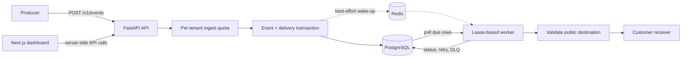

<p align="center">
  
</p>

[](https://github.com/sajadxdp0/hookflow/actions/workflows/ci.yml)
[](https://www.python.org/downloads/)
[](LICENSE)
[](docs/PRODUCT.md)

<p align="center">
  <strong>Durable webhook delivery for applications that cannot afford to lose an event.</strong>
</p>

HookFlow accepts an event only after it and its initial delivery are committed to the database. A lease-based worker then delivers the signed payload asynchronously, retries transient failures with backoff, and keeps a queryable delivery history with dead-letter replay.

Built for backend teams that need a self-hosted delivery layer between their producers and customer webhook receivers.

## Features

- **Persist-first ingest** — `201` means the event and delivery are durably committed; Redis is only a wake-up hint.
- **At-least-once delivery** — bounded retries, exponential backoff, expired-lease recovery, and a dead-letter queue.
- **Signed payloads** — per-endpoint HMAC-SHA256 signatures over the exact bytes sent, with secrets encrypted at rest.
- **Idempotent producers** — endpoint-scoped idempotency keys return the original event; reusing a key with a different payload returns `409`.
- **Endpoint lifecycle** — create, list, update, pause, rotate signing secrets, and safely delete endpoints.
- **Tenant isolation and quotas** — API keys resolve to one tenant; per-tenant ingest limits default to 600 requests/minute.
- **Safe outbound requests** — public HTTP(S) destinations only, delivery-time IP validation, and redirects disabled.
- **Operator visibility** — delivery history, queue statistics, readiness checks, Prometheus-format metrics, and a server-rendered dashboard.

## Architecture



PostgreSQL is the source of truth. Workers always poll due rows, so a lost Redis wake-up costs latency rather than an accepted event. See [architecture](docs/architecture.md) for the delivery state machine and failure behavior.

## Quick start with uv

Prerequisites: Python 3.11+, [uv](https://docs.astral.sh/uv/), and `openssl`. SQLite and database polling make the local path dependency-free.

```bash
git clone https://github.com/sajadxdp0/hookflow.git
cd hookflow
uv sync --extra dev
cp .env.example .env

uv run alembic upgrade head
uv run uvicorn app.main:app --reload
```

In a second terminal, start a worker:

```bash
uv run python -m app.worker
```

Set a strong `SECRET_ENCRYPTION_KEY` in `.env` before storing real events. The published development key exists only to make local setup convenient; `/ready` reports when it is in use. Set `HOOKFLOW_ADMIN_TOKEN` to a separate, strong random value in the API process environment before using the provisioning API.

The interactive API is available at `http://localhost:8000/docs`. Follow [API examples](#api-examples) to provision a tenant and send your first event.

## Docker quick start

Run PostgreSQL, Redis, the API, and a worker together:

```bash
docker compose -f docker/docker-compose.yml up --build -d app worker
```

The API listens on `http://localhost:8000`. Compose runs a dedicated **one-shot migration service** before application and worker startup, so replicas never race schema changes.

The supplied Compose configuration uses development credentials, publishes database ports, and does not terminate TLS. Use it for local evaluation, not as a production template. See [deployment](docs/deployment.md) before exposing HookFlow.

## API examples

These examples use `curl` and `jq`. Set `HOOKFLOW_URL` to your API origin and use the same `HOOKFLOW_ADMIN_TOKEN` configured for the API. Store returned credentials in a secret manager, not shell history.

```bash
export HOOKFLOW_URL="http://localhost:8000"
read -rsp "Admin token: " HOOKFLOW_ADMIN_TOKEN; echo
export HOOKFLOW_ADMIN_TOKEN
```

### 1. Provision a tenant and API key

The admin routes fail closed when `HOOKFLOW_ADMIN_TOKEN` is unset. Plaintext API keys are returned only once; only their SHA-256 digests are stored.

```bash
TENANT_ID=$(curl -fsS -X POST "$HOOKFLOW_URL/v1/admin/tenants" \
  -H "X-Admin-Token: $HOOKFLOW_ADMIN_TOKEN" \
  -H 'Content-Type: application/json' \
  -d '{"name":"acme"}' | jq -er '.id')

KEY_RESPONSE=$(curl -fsS -X POST \
  "$HOOKFLOW_URL/v1/admin/tenants/$TENANT_ID/keys" \
  -H "X-Admin-Token: $HOOKFLOW_ADMIN_TOKEN" \
  -H 'Content-Type: application/json' \
  -d '{"label":"production"}' \
  | jq -er '{id, tenant_id, key_prefix, api_key}')

export HOOKFLOW_API_KEY=$(jq -er '.api_key' <<<"$KEY_RESPONSE")
```

### 2. Create an endpoint

The destination must be a public HTTP(S) URL. A server-generated signing secret and `enabled: true` are returned in the `201` response; the secret is never returned by another endpoint read.

```bash
ENDPOINT_RESPONSE=$(curl -fsS -X POST "$HOOKFLOW_URL/v1/endpoints" \
  -H "Authorization: Bearer $HOOKFLOW_API_KEY" \
  -H 'Content-Type: application/json' \
  -d '{
    "url": "https://receiver.example.com/hooks/hookflow",
    "rate_limit_per_minute": 120
  }')

ENDPOINT_ID=$(jq -er '.id' <<<"$ENDPOINT_RESPONSE")
ENDPOINT_SECRET=$(jq -er '.secret' <<<"$ENDPOINT_RESPONSE")
```

Give `ENDPOINT_SECRET` to the receiver's secret store. The default tenant cap is 100 endpoints, configurable with `MAX_ENDPOINTS_PER_TENANT`.

### 3. Send an event

The response includes both the event ID and its initial delivery ID. A `201` is returned after the database commit, not after the receiver acknowledges.

```bash
EVENT_RESPONSE=$(curl -fsS -X POST "$HOOKFLOW_URL/v1/events" \
  -H "Authorization: Bearer $HOOKFLOW_API_KEY" \
  -H 'Idempotency-Key: order-1042-v1' \
  -H 'Content-Type: application/json' \
  -d "{
    \"endpoint_id\": \"$ENDPOINT_ID\",
    \"payload\": {\"order_id\": 1042, \"status\": \"paid\"}
  }")

EVENT_ID=$(jq -er '.id' <<<"$EVENT_RESPONSE")
DELIVERY_ID=$(jq -er '.delivery_id' <<<"$EVENT_RESPONSE")
```

Repeating the same request returns the original IDs with `deduplicated: true`. Reusing `order-1042-v1` for this endpoint with a different payload returns `409`. Idempotency is scoped to an endpoint and does not make downstream side effects exactly-once.

### 4. Verify the signature

HookFlow sends `Content-Type: application/json` and `X-Hookflow-Signature: sha256=<hex digest>`. Verify the **raw request bytes** before parsing or re-serializing JSON:

```python
import hashlib
import hmac


def verify_signature(secret: str, raw_body: bytes, provided: str) -> bool:
    expected = "sha256=" + hmac.new(
        secret.encode("utf-8"), raw_body, hashlib.sha256
    ).hexdigest()
    return hmac.compare_digest(expected, provided)
```

Reject a request when verification fails, then process it idempotently. Retries and DLQ replays can produce duplicate deliveries even when every signature is valid.

### 5. Inspect and replay

```bash
curl -fsS "$HOOKFLOW_URL/v1/deliveries?status=dlq" \
  -H "Authorization: Bearer $HOOKFLOW_API_KEY"

curl -fsS -X POST \
  "$HOOKFLOW_URL/v1/deliveries/$DELIVERY_ID/requeue" \
  -H "Authorization: Bearer $HOOKFLOW_API_KEY"
```

Replay accepts only `dlq` deliveries and resets their attempt count. Other states, including `success`, return `409`. Fix the receiver before replaying a dead letter.

### 6. Manage the endpoint

```bash
# Update URL, delivery rate limit, or enabled state; returns Endpoint.
curl -fsS -X PATCH "$HOOKFLOW_URL/v1/endpoints/$ENDPOINT_ID" \
  -H "Authorization: Bearer $HOOKFLOW_API_KEY" \
  -H 'Content-Type: application/json' \
  -d '{"enabled": false}'

# Rotate the signing secret; {id, secret} is returned once.
ROTATED=$(curl -fsS -X POST \
  "$HOOKFLOW_URL/v1/endpoints/$ENDPOINT_ID/rotate-secret" \
  -H "Authorization: Bearer $HOOKFLOW_API_KEY")

# Delete only when no queued or retrying deliveries remain.
curl -fsS -X DELETE "$HOOKFLOW_URL/v1/endpoints/$ENDPOINT_ID" \
  -H "Authorization: Bearer $HOOKFLOW_API_KEY" -o /dev/null
```

`DELETE` returns `204` on success and `409` while queued or retrying deliveries exist. Deletion also removes associated event and delivery history; export anything you need first. For secret rotation, pause delivery, call the rotation endpoint, update the receiver's secret, then re-enable delivery.

## Dashboard

The Next.js dashboard is an operator UI for endpoints, delivery history, the DLQ, API keys, metrics, and readiness. All HookFlow API calls happen in server components or server actions. Access is protected by a fail-closed HTTP Basic gate.

```bash
cd dashboard
cp .env.example .env.local
npm ci
npm run dev
```

Configure these variables in `dashboard/.env.local` before opening the dashboard:

| Variable | Default | Purpose |
|---|---|---|
| `DASHBOARD_USERNAME` | `admin` | Username for the dashboard Basic access gate. |
| `DASHBOARD_PASSWORD` | unset | Required dashboard access password. Access fails closed when it is missing. |
| `HOOKFLOW_API_URL` | `http://localhost:8000` | HookFlow API origin used by the Next.js server. |
| `HOOKFLOW_API_KEY` | unset | Tenant API key used for tenant-scoped views. |
| `HOOKFLOW_TENANT_ID` | unset | Tenant whose API keys are displayed. |
| `HOOKFLOW_ADMIN_TOKEN` | unset | Optional dashboard-side admin credential for the API-key management view; use the API's admin token. |

`HOOKFLOW_API_URL`, `HOOKFLOW_API_KEY`, `HOOKFLOW_TENANT_ID`, and the dashboard's copy of `HOOKFLOW_ADMIN_TOKEN` configure only the dashboard process. The API and worker do not read them; the API separately requires its own admin-token setting to guard provisioning.

Never prefix these variables with `NEXT_PUBLIC_`. Doing so inlines their values into browser bundles. In production, the dashboard must be served over **HTTPS** so Basic credentials are never sent in plaintext; direct HTTP is only appropriate on loopback for local development. The dashboard is not a customer-facing portal or a replacement for per-operator API authentication.

To run the dashboard with Compose, set `HOOKFLOW_API_KEY` and `HOOKFLOW_TENANT_ID` in your shell, then enable the `dashboard` profile with a strong password:

```bash
read -rsp "Dashboard password: " DASHBOARD_PASSWORD; echo
export DASHBOARD_PASSWORD
docker compose -f docker/docker-compose.yml --profile dashboard up --build -d dashboard
```

`DASHBOARD_PASSWORD` is required for the dashboard Compose profile. The dashboard listens on port 3000; terminate TLS at a reverse proxy before exposing it beyond localhost.

## Configuration

| Variable | Default | Purpose |
|---|---|---|
| `HOOKFLOW_ENVIRONMENT` | `development` | Set to `production` for production deployments. |
| `DATABASE_URL` | `sqlite:///./hookflow.db` | Use PostgreSQL in production. |
| `REDIS_URL` | empty | Enables Redis wake-ups and shared limiter state; required for replica-safe quotas. |
| `SECRET_ENCRYPTION_KEY` | empty | Fernet key or passphrase protecting endpoint secrets; production must supply one. |
| `HOOKFLOW_ADMIN_TOKEN` | empty | Guards tenant/key provisioning; unset makes those routes fail closed. |
| `INGEST_RATE_LIMIT_PER_MINUTE` | `600` | Per-tenant event-ingest quota; rejected requests receive `429` and `Retry-After`. |
| `MAX_ENDPOINTS_PER_TENANT` | `100` | Maximum endpoints owned by one tenant. |
| `DEFAULT_RATE_LIMIT_PER_MINUTE` | `60` | Default per-endpoint delivery limit. |
| `MAX_BODY_BYTES` | `262144` | Maximum serialized event payload size. |
| `DELIVERY_TIMEOUT_SECONDS` | `10.0` | Timeout for one outbound attempt. |
| `CLAIM_LEASE_SECONDS` | `60.0` | Worker lease; keep comfortably above the delivery timeout. |
| `MAX_ATTEMPTS` | `5` | Attempts before a delivery moves to `dlq`. |
| `BACKOFF_SCHEDULE_SECONDS` | `[60,300,1800,7200,43200]` | Retry delays after failures; the last delay repeats. |

See [deployment](docs/deployment.md) for production settings and operational requirements.

## Security and reliability

- **Durable acceptance:** the event and initial delivery commit together before `201`; Redis wake-up failure does not discard committed work.
- **Bounded recovery:** workers claim rows atomically, recover expired leases, retry failures, and move exhausted deliveries to `dlq` for explicit replay.
- **Authenticated isolation:** bearer API keys resolve to exactly one tenant; another tenant's resources return `404`.
- **Protected secrets:** endpoint secrets are Fernet-encrypted at rest and returned once. API keys are stored only as SHA-256 digests.
- **Delivery-time egress checks:** loopback, private, link-local, and reserved destinations are rejected; redirects are not followed.
- **Operational signals:** `/health` is liveness, `/ready` checks the database/schema, configured Redis, and encryption posture, and `/metrics` exposes process-local counters.

### Production requirements

- Use **PostgreSQL** and run `alembic upgrade head` once per release before rolling application replicas.
- Configure **Redis** for cross-replica ingest quotas and endpoint delivery limits; without it, limits are per process.
- Terminate **TLS** at a trusted reverse proxy or load balancer. Compose does not provide TLS.
- Allow worker egress only to the **public HTTP(S) destinations** you intend to call; private-network destinations are intentionally blocked.
- Back up the database **and** `SECRET_ENCRYPTION_KEY` together. Losing the key makes stored endpoint secrets unrecoverable; lost one-time API keys or receiver-side endpoint secrets cannot be retrieved by HookFlow.
- Design receivers for **at-least-once** delivery and deduplicate side effects using the event ID or your own business key.

Read the full [security model](docs/security.md), [deployment guide](docs/deployment.md), and [database guide](docs/database.md).

## Honest limitations

- Delivery is at-least-once, not exactly-once, and ordering across events is not guaranteed.
- API keys can be revoked but do not expire. The admin surface uses one shared token, without per-operator roles or an admin audit log.
- Quotas and per-endpoint limits are replica-safe only with Redis; memory fallback is for a single local process.
- There is no automatic data-retention policy, built-in TLS termination, managed high availability, or delivery SLO.
- `/metrics` is unauthenticated and counters are process-local. Restrict it at the network or proxy layer.
- SQLite is for local development and tests, not production.

Historical benchmark data and its limitations are preserved in [performance](docs/performance.md); they are not a capacity commitment for 0.2.0.

## Documentation and community

- [Product guide](docs/PRODUCT.md)
- [Architecture](docs/architecture.md)
- [Security](docs/security.md)
- [Deployment](docs/deployment.md)
- [Database and migrations](docs/database.md)
- [Performance](docs/performance.md)
- [Changelog](CHANGELOG.md)
- [Contributing](CONTRIBUTING.md)
- [Security policy](SECURITY.md)
- [Code of conduct](CODE_OF_CONDUCT.md)

Topics: #webhooks #webhook-delivery #event-driven #fastapi #python #postgresql #redis #reliability #self-hosted #nextjs

## License

HookFlow is available under the [MIT License](LICENSE).
