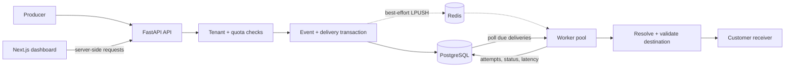

# HookFlow architecture

HookFlow 0.2.0 is a persist-first webhook delivery service. Producers submit events to a tenant-scoped HTTP API; workers sign and POST them to public customer receivers; PostgreSQL records every state transition. Redis improves wake-up latency and shares quota counters, but it is not the system of record.

## System shape



| Component | Responsibility |
|---|---|
| FastAPI API | Authenticate API keys, enforce tenant scope and ingest quotas, manage endpoints, persist events, expose history and operational routes. |
| PostgreSQL | Durable ownership of tenants, keys, endpoints, events, deliveries, claims, retry state, and idempotency. |
| Redis | Best-effort delivery wake-ups and shared fixed-window counters for ingest and delivery limits. |
| Worker | Claim due rows, validate destinations, decrypt signing secrets, send signed HTTP requests, and persist retry/success/DLQ outcomes. |
| Dashboard | Server-rendered operator views; API credentials stay in the Next.js server environment. |

## Ingest path

1. The caller presents `Authorization: Bearer hf_<prefix>_<secret>`. Authentication resolves one API key and exactly one tenant.
2. The API checks the tenant's fixed-window ingest quota. The default is 600 requests per minute; rejection returns `429` with `Retry-After`.
3. The endpoint must belong to that tenant. URLs and payloads are validated, and the serialized payload must fit `MAX_BODY_BYTES` (256 KiB by default).
4. An `Idempotency-Key` header or request-body key is scoped to the endpoint. An identical replay returns the original event and delivery. Reusing the key with a different payload returns `409`.
5. The `Event` and initial `Delivery` rows commit in one transaction. Only after commit does the API return `201` and attempt a Redis wake-up.
6. A Redis failure cannot roll back the committed event. The worker's database poll remains the recovery path.

The database uniqueness constraint on `(endpoint_id, idempotency_key)` closes concurrent-insert races. Payload comparison is also required: uniqueness alone cannot distinguish a legitimate replay from key reuse with different content.

## Delivery state machine

```text
queued --worker claims--> in-flight (not a persisted status)
in-flight --2xx---------> success
in-flight --failure, attempts remaining--> retrying --next_attempt_at due--> worker claim
in-flight --failure, MAX_ATTEMPTS reached--> dlq
dlq --POST /v1/deliveries/{id}/requeue--> queued (attempts reset)
```

- Any `2xx` response is success. Network errors, timeouts, `5xx`, and `408`/`409`/`425`/`429` retry; other `4xx` responses dead-letter immediately.
- Default retry delays after failed attempts are 60 seconds, 5 minutes, 30 minutes, 2 hours, and 12 hours. The last delay repeats if a custom schedule is exhausted before `MAX_ATTEMPTS`.
- The default `MAX_ATTEMPTS` is 5. Exhaustion moves the delivery to `dlq`; it does not silently disappear.
- Requeue accepts only `dlq`. `queued`, `retrying`, and `success` return `409`.
- Delivery order is not guaranteed. Concurrent workers and endpoint rate limits can reorder events.

### Claims and leases

Workers atomically claim due batches with a batch-unique token. On PostgreSQL, the candidate query uses `FOR UPDATE SKIP LOCKED`, allowing replicas to work in parallel without queuing behind each other. `claim_token` and `claimed_at` form a lease; expired claims are released for recovery.

Claims reduce duplicate work; they do not create exactly-once delivery. A worker can crash after the receiver commits a side effect but before HookFlow records success, or a request can outlive its lease. Receivers must deduplicate. Keep `CLAIM_LEASE_SECONDS` comfortably above `DELIVERY_TIMEOUT_SECONDS` to reduce avoidable overlap.

## Endpoint lifecycle

`POST /v1/endpoints` creates an enabled endpoint and returns its plaintext signing secret once. Subsequent endpoint reads never include that secret. The tenant cap defaults to 100 (`MAX_ENDPOINTS_PER_TENANT`).

`PATCH /v1/endpoints/{id}` accepts `url`, `rate_limit_per_minute`, and `enabled`. Disabled endpoints are not dispatched. `POST /v1/endpoints/{id}/rotate-secret` replaces the signing secret and returns `{id, secret}` once.

`DELETE /v1/endpoints/{id}` returns `204` only when no queued or retrying deliveries remain; otherwise it returns `409`. Deletion cascades to associated event and delivery history, so export required records first.

## Destination safety

Before each outbound attempt, the worker resolves the configured URL and rejects loopback, private, link-local, multicast, unspecified, and reserved addresses. Both IPv4 and IPv6 are checked. Redirects are disabled so a public URL cannot bounce the worker into a private network.

This is an SSRF control, not a guarantee that a hostname will remain publicly routable forever. Every attempt resolves again, validates every address, and pins the connection to a validated IP while preserving the original Host header and TLS SNI. Operators should still use egress firewalls and allowlists. Plain HTTP is accepted for compatibility, but production receivers should use HTTPS.

## Quotas and scaling

Two independent limits apply:

- **Ingest:** per tenant, default 600 requests/minute (`INGEST_RATE_LIMIT_PER_MINUTE`).
- **Delivery:** per endpoint, default 60 requests/minute (`DEFAULT_RATE_LIMIT_PER_MINUTE` or the endpoint's configured value).

Both use fixed 60-second windows. Redis supplies shared state across replicas. Without Redis, counters live in each process, so multiple replicas each receive an independent budget. Redis is therefore required for replica-safe quotas even though database polling preserves delivery recovery without it.

Scale API and worker replicas independently. PostgreSQL connection capacity, durable commit latency, receiver capacity, and quota settings bound useful concurrency. There is no built-in autoscaler or global ordering coordinator.

## Failure behavior

| Failure | Expected behavior |
|---|---|
| Redis wake-up is lost | Worker finds the committed delivery by polling PostgreSQL. |
| Redis is unavailable | Database polling continues; restore Redis before relying on cross-replica quota consistency. |
| API process exits after commit, before response | Producer retry with the same idempotency key returns the committed event. |
| Worker exits before sending | Lease expires and another worker can claim the row. |
| Receiver times out or returns non-`2xx` | Attempt is recorded and the delivery retries or dead-letters. |
| Worker exits after receiver success, before status commit | The row can be redelivered; receiver idempotency is required. |
| Destination resolves to a non-public address | Attempt is rejected; no request is sent to that address. |
| Schema is missing | `/ready` returns `503` with migration guidance. |

## Observability and boundaries

- `/health` checks process liveness.
- `/ready` checks database/schema availability, configured Redis, and whether the development encryption key is active.
- `/metrics` exposes Prometheus-text process counters for ingest, deduplication, and requeue.
- `/v1/stats` reports tenant-scoped counts by delivery status and current queue depth.
- `X-Request-ID` supports request correlation.

Metrics counters are in-process and reset on restart. `/metrics` is unauthenticated; restrict it at the proxy or network layer. HookFlow does not provide an admin audit trail, API-key expiry, automatic retention, or per-operator authorization. See [security](security.md) and [deployment](deployment.md) for the operating model.
